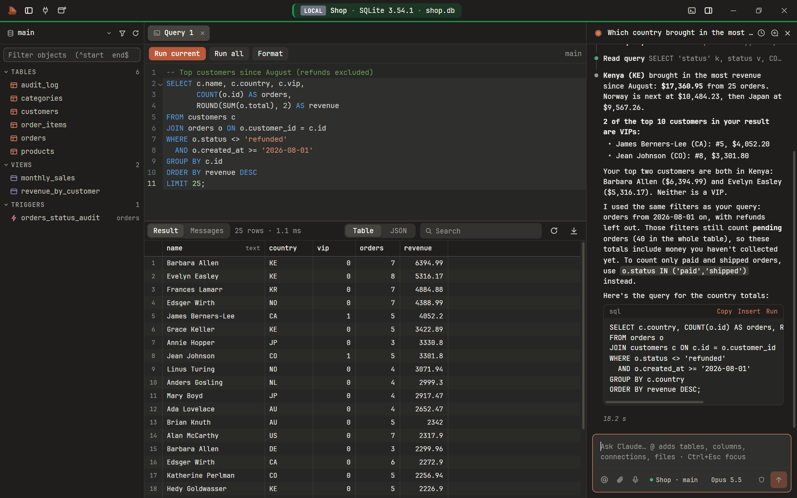
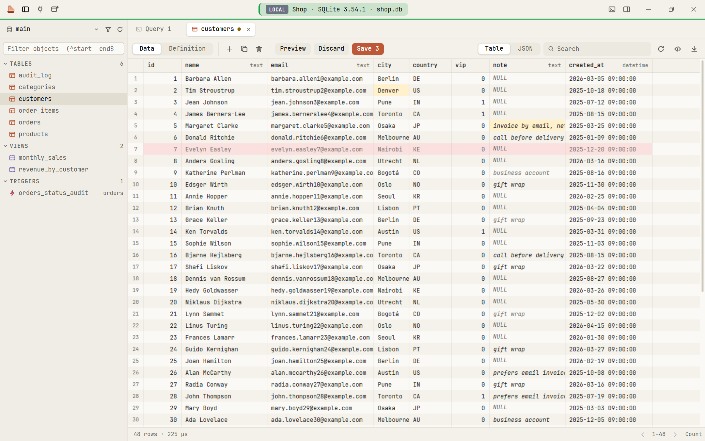
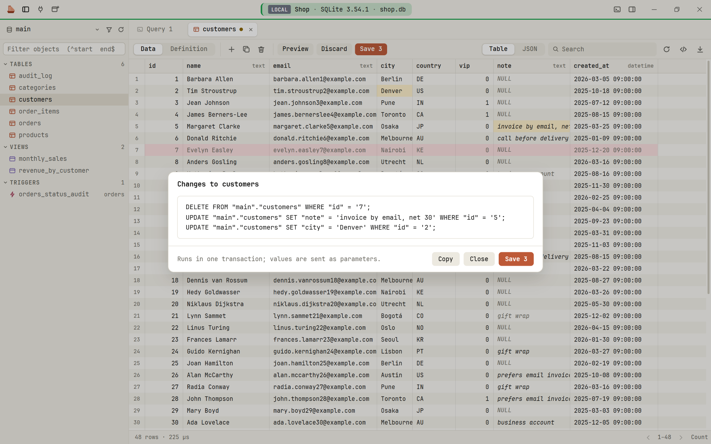
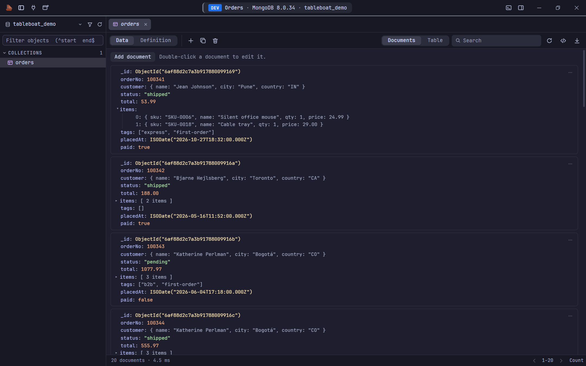
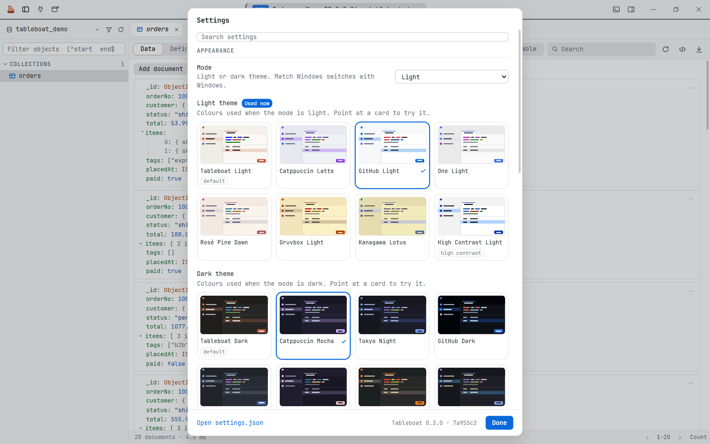
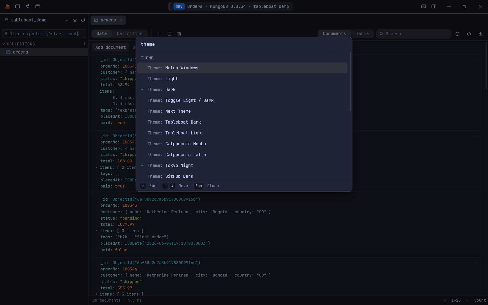
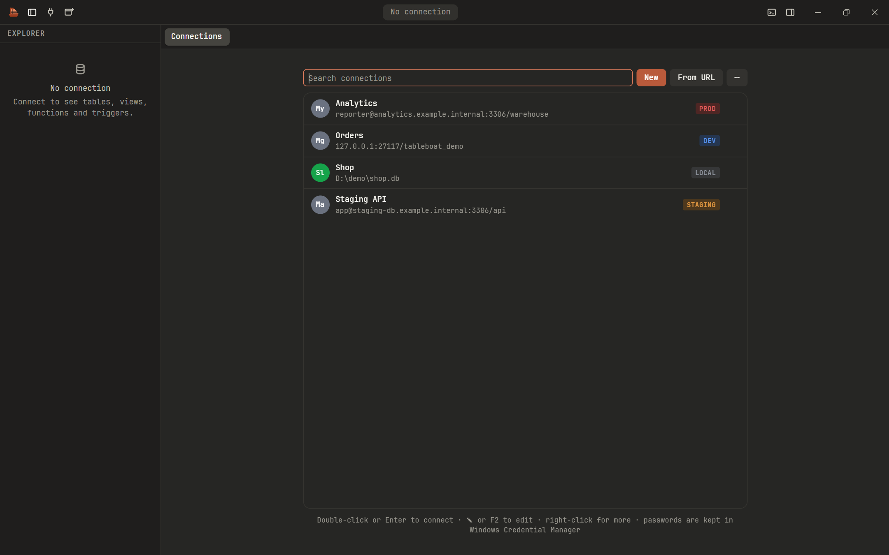

# Tableboat

A small, fast desktop database client for **Windows and macOS**: **MySQL, MariaDB, SQLite and MongoDB**,
with a SQL editor, a results grid with safe editing, a command line (`tb`), and **Claude Code** built in.

Built with [Tauri 2](https://tauri.app) (Rust backend, and the WebView your system already has:
WebView2 on Windows, WebKit on macOS). No Electron and no Node.js at runtime: about 140 MB of memory
with a connection open on Windows, and no CPU use while idle.

> Status: early (v0.4), on Windows and macOS, used daily by its author on Windows. The macOS build is
> new: expect rough edges there.



## Features

- **Connections:** MySQL, MariaDB, SQLite and MongoDB (incl. `mongodb+srv://`), over SSH tunnels and SSL.
  Passwords are kept in the system keychain (Windows Credential Manager, macOS Keychain). Paste a
  connection URL to add one; colours and tags (`tb` refuses to write to a connection tagged
  `production` unless you confirm).
- **Browse:** databases, tables, views, functions, procedures and triggers in a searchable sidebar; table data
  a page at a time, sorted on the server; table definitions.
- **SQL editor:** several statements per tab, run the current one or all, autocomplete from the schema, a
  formatter, `DELIMITER` blocks, cancel. MongoDB queries in mongosh syntax (`db.users.find({ … })`).
- **Results:** a fast grid that only draws visible rows; quick search, sort, copy and export as CSV, Excel,
  JSON, Markdown or SQL `INSERT`s. Edit cells, add and delete rows, preview the SQL, save in one transaction.
- **MongoDB documents:** results shown as documents with their nesting and types (`ObjectId`, `ISODate`,
  `NumberLong`, decimals…), or as a table. Edit, duplicate, add and delete whole documents.
- **Claude Code pane** (optional): ask about your data next to the editor. Claude reads the schema and runs
  read-only queries (the database enforces read-only); anything that changes data or settings asks you
  first. It can also work the app: add or edit connections, change settings, export tables or whole databases.
- **`tb` command line:** everything above from a terminal: `tb query`, `tb export`, `tb dump`, `tb ask` and
  more. See [docs/CLI.md](docs/CLI.md).
- **Updates:** Tableboat tells you when a new version is out and installs it for you (signed and verified).
- Several windows, tabs restored per connection, 19 colour themes (Catppuccin, Tokyo Night, GitHub, One Dark, Rosé Pine, Gruvbox, Kanagawa, Nord, Dracula, High Contrast), three densities, command palette.

## Screenshots

All screenshots are of the real app on a made-up demo shop database (see
[scripts/screenshots](scripts/screenshots/README.md) to recreate them).

| | |
|---|---|
|  |  |
| **Safe editing.** Change cells and delete or add rows; nothing is written until you save. *(Tableboat Light)* | **Preview the SQL** before saving; it runs in one transaction with parameters. |
|  |  |
| **MongoDB documents** with their nesting and types. *(Catppuccin Mocha)* | **19 themes:** pick one for light mode and one for dark; hover a card to try it. *(GitHub Light)* |
|  |  |
| **Command palette** for every action. *(Tokyo Night)* | **Connections** with colours and tags; passwords stay in the system keychain. |

## Install

Download from the [latest release](https://github.com/yash-desai-naik/tableboat/releases/latest):

**Windows 10 and 11 (64-bit):** run `Tableboat_<version>_x64-setup.exe`. It installs for your Windows
user only (no administrator rights) into `%LOCALAPPDATA%\Tableboat` and puts the `tb` command on your
PATH.

**macOS 11 or later (Apple Silicon):** open `Tableboat_<version>_aarch64.dmg` and drag Tableboat into
Applications. To use `tb` in a terminal, link it once:

```sh
sudo ln -s /Applications/Tableboat.app/Contents/MacOS/tb /usr/local/bin/tb
```

After that, Tableboat tells you about new versions and installs them itself (or check any time:
About > Check for updates); your connections and settings are kept.

Neither build is code-signed yet. On Windows, if SmartScreen says "Windows protected your PC", click
**More info**, then **Run anyway**. On macOS, the first time you open Tableboat, right-click it in
Applications and choose **Open** (or run
`xattr -dr com.apple.quarantine /Applications/Tableboat.app`), then confirm. Each release lists the
SHA-256 checksums so you can check them. What changed in each version: [CHANGELOG.md](CHANGELOG.md).

## Build from source

### Requirements

- Windows 10 or 11 (WebView2, which Windows 11 already has) with the Microsoft C++ build tools, or
  macOS 11 or later on Apple Silicon with the Xcode Command Line Tools (`xcode-select --install`)
- [Rust](https://rustup.rs) (stable)
- [Node.js](https://nodejs.org) 20+ (only to build the UI)
- Optional: [Claude Code](https://claude.com/claude-code), signed in, for the Claude pane and `tb ask`
  (it runs under your own Claude account)

### Steps

```sh
git clone https://github.com/yash-desai-naik/tableboat.git
cd tableboat
npm install
npx tauri build
```

On Windows the installer is `src-tauri\target\release\bundle\nsis\Tableboat_<version>_x64-setup.exe`; on
macOS the DMG is `src-tauri/target/release/bundle/dmg/Tableboat_<version>_aarch64.dmg` (or under
`target/aarch64-apple-darwin/` when built with `--target aarch64-apple-darwin`).

To run it while developing: `npx tauri dev`. More in [docs/DEVELOPMENT.md](docs/DEVELOPMENT.md).

## Documentation

- [CHANGELOG.md](CHANGELOG.md): what changed in each version
- [docs/CLI.md](docs/CLI.md): the `tb` command line
- [docs/DEVELOPMENT.md](docs/DEVELOPMENT.md): building, code layout, tests
- [docs/SCOPE.md](docs/SCOPE.md) and [docs/PLAN.md](docs/PLAN.md): what's in scope and how it's built

## Contributing

Issues and pull requests are welcome. Please keep the project's budget in mind: low memory, no idle CPU,
and no Node.js at runtime.

## Credits

Theme palettes are based on Catppuccin, Tokyo Night, GitHub Primer, One Dark/One Light, Rosé Pine,
Gruvbox, Kanagawa, Nord and Dracula, all MIT-licensed. Only their colour values are used, some nudged
for contrast (see [docs/THEMES.md](docs/THEMES.md)).

## License

[MIT](LICENSE) © 2026 Yash Desai

Tableboat is an independent project. It is not affiliated with or endorsed by TablePlus, Anthropic, MongoDB,
Oracle (MySQL) or any other company whose products it works with or mentions. Product names are trademarks of
their owners.
